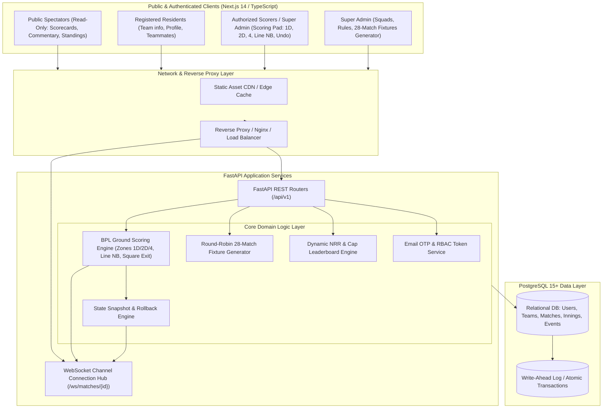

# SYSTEM ARCHITECTURE: BAIRAJESHWAR PREMIER LEAGUE (BPL)

## 1. Executive Architectural Overview

The **Bairajeshwar Premier League (BPL)** tournament platform is designed as a **public-first, real-time, database-driven sports management and broadcast platform**. It caters specifically to the official **BPL box cricket ground configuration**:
- An open-air **defined playing square** (with **NO overhead net**).
- **Direct out of square on the full = OUT**.
- Designated scoring zones: **1D (1 run), 2D (2 runs), 4 (4 runs)**.
- **Physical running** between the wickets for both striker and non-striker.
- Strict **line no-balls** (+1 run, re-bowled, not counted as a legal delivery).

The architecture strictly enforces:
1. **Public-First Access**: Anonymous, zero-friction consumption of live scores, schedules, scorecards, leaderboards, and team rosters without mandatory authentication.
2. **Deterministic State-Sourced Scoring Engine**: Server-authoritative calculation of deliveries, zone runs, physical runs run, line no-balls, strike rotations, and instantaneous **Undo** capability.
3. **Role-Based Authorization Gate**: Scorer and Super Admin write isolation via cryptographically signed JWT sessions.
4. **Low-Latency Event-Driven Broadcasting**: WebSocket channel hubs streaming live delivery deltas with heartbeat reconnection and auto-hydration.

---

## 2. High-Level Architecture Diagram

---

## 3. Subsystem Architectural Breakdown

### 3.1 Ground Configuration & Rule Modeling
- **Playing Area**: Defined marked square.
- **Overhead Net**: Completely absent. All roof/net hit rules, deflections, and references have been removed from the platform.
- **Direct Out of Square**: Ball hit directly beyond the square perimeter without touching the turf is recorded as a dismissal (`DIRECT_OUT_OF_SQUARE`).
- **Scoring Zones**: The ground features designated boundaries:
  - `1D`: 1 run awarded.
  - `2D`: 2 runs awarded.
  - `4`: 4 runs awarded.
- **Physical Running**: Striker and non-striker can run additional runs. Strike rotates on odd physical runs completed.
- **Line No-Ball**: Bowler delivering behind/over the marked crease line results in +1 extra run, ball is not counted as legal, and must be re-bowled.

### 3.2 Frontend Architecture (Next.js 14 App Router)
- **Framework**: Next.js 14 with React 18, TypeScript, and Tailwind CSS.
- **Visual Identity**: Deep Emerald Green (`#047857`, `#064e3b`), Golden Yellow (`#fbbf24`), Pitch Dark Background (`#06130d`), and Slate typography.
- **Public-First Philosophy**: No route in the public browsing surface prompts or requires an account. Read operations never verify tokens.

### 3.3 Backend Architecture (FastAPI + SQLAlchemy 2.0)
- **Framework**: Python 3.11+ / FastAPI for asynchronous, high-throughput I/O.
- **Scoring Engine**: Implements the BPL ground configuration with state snapshotting (`previous_state_snapshot` in JSONB) on every delivery for 100% bug-free undo.
- **Concurrency & Transaction Safety**: Every ball event execution runs within an atomic database transaction (`db.commit()`), guaranteeing zero half-written state if a worker process interrupts.

### 3.4 Real-Time Communication Hub
- **Protocol**: Raw RFC 6455 WebSockets for sub-millisecond score broadcasting.
- **Channel Isolation**: Clients subscribe to `/ws/matches/{match_id}`.
- **Public Live Updates**: Spectators connect without tokens; scorecards update immediately upon any scorer delivery or undo action.

---

## 4. Security & Permissions Matrix

| Resource / Capability | Public Visitor | Registered User | Team Captain | Scorer | Super Admin |
| :--- | :---: | :---: | :---: | :---: | :---: |
| View Live Scores & Commentary | ✅ | ✅ | ✅ | ✅ | ✅ |
| View Fixtures & Scorecards | ✅ | ✅ | ✅ | ✅ | ✅ |
| View Points Table & Player Caps | ✅ | ✅ | ✅ | ✅ | ✅ |
| View Personal Profile & Squad | ❌ | ✅ | ✅ | ✅ | ✅ |
| Record Ball Delivery / Extras | ❌ | ❌ | ❌ | ✅ | ✅ |
| Undo Delivery | ❌ | ❌ | ❌ | ✅ | ✅ |
| Change Bowler / Batsman Crease | ❌ | ❌ | ❌ | ✅ | ✅ |
| Initialize Match Lineups & Toss | ❌ | ❌ | ❌ | ✅ | ✅ |
| Create Franchises & Assign Squads | ❌ | ❌ | ❌ | ❌ | ✅ |
| Generate Round-Robin Schedule | ❌ | ❌ | ❌ | ❌ | ✅ |
| Configure BPL Ground Rules | ❌ | ❌ | ❌ | ❌ | ✅ |
| Assign Captains & Scorer Roles | ❌ | ❌ | ❌ | ❌ | ✅ |
