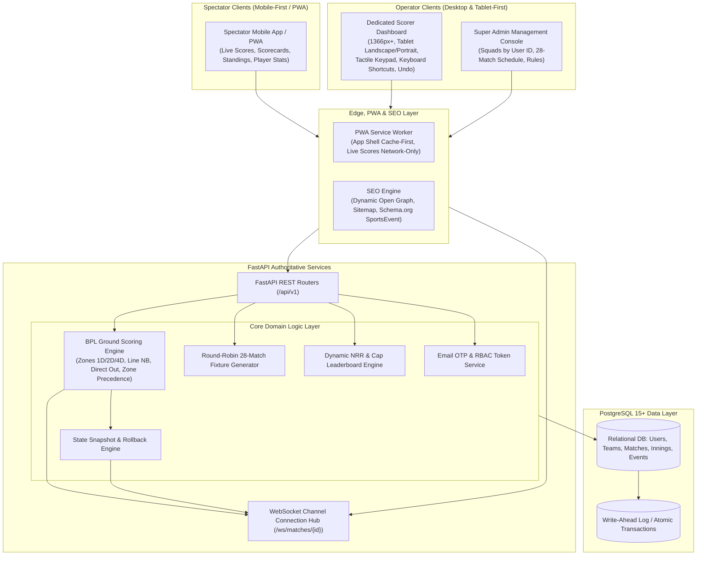

# SYSTEM ARCHITECTURE: BAIRAJESHWAR PREMIER LEAGUE (BPL)

## 1. Executive Architectural Overview & Differentiated Device Strategy

The **Bairajeshwar Premier League (BPL)** tournament platform is designed as a **public-first, real-time, database-driven sports management and broadcast platform**. It implements a strict **differentiated device strategy**:

1. **Spectators (Mobile-First)**:
   - Primary Device: Smartphones (iOS Safari, Android Chrome, PWA).
   - Clean, thumb-friendly app-like interface.
   - Zero login friction (no authentication wall, no registration popup).
   - Fast-loading live match scoreboard, ball-by-ball commentary, team pages, points table, and cap leaderboards.
2. **Scorers (Desktop & Tablet-First)**:
   - Primary Devices: Laptops (1366px+) and Tablets (iPad/Android tablets in landscape/portrait).
   - High-tactility scoring dashboard with zero scrolling required.
   - Confirmed BPL box cricket ground rules: `0`, `1D`, `2D`, `4D FIXED`, `NO_BALL (+1 repeat)`, `DIRECT_OUT`.
   - Double-tap debounce protection, physical keyboard shortcuts (`0`, `1`, `2`, `4`, `N`, `W`, `Z`), and atomic undo.
   - Two-step confirmation for innings and match termination.
3. **Super Admin (Desktop & Tablet-First)**:
   - Multi-column franchise squad manager, player assignment by unique BPL User ID (`BPL001`), captain assignments, and 28-match fixture generator.

All client experiences consume a single authoritative **FastAPI backend**, **PostgreSQL database**, and **low-latency WebSocket channels**.

---

## 2. High-Level Architecture Diagram

---

## 3. Subsystem Architectural Breakdown

### 3.1 Ground Configuration & Rule Modeling
- **Playing Area**: Defined marked square.
- **Overhead Net**: Completely absent. All roof/net hit rules, deflections, and references have been removed from the platform.
- **Direct Out of Square**: Ball hit directly beyond the square perimeter without touching the turf is recorded as a dismissal (`DIRECT_OUT`).
- **Scoring Zones**: The ground features designated boundaries:
  - `ONE_D`: 1 run awarded (+ any running runs).
  - `TWO_D`: 2 runs awarded (+ any running runs).
  - `FOUR_D`: FIXED 4 runs awarded (running runs not allowed).
- **Physical Running (`RUNS_COMPLETED`)**: Striker and non-striker can run completed runs. Strike rotates on odd physical runs completed.
- **Line No-Ball (`NO_BALL`)**: Bowler delivering behind/over the marked line results in +1 extra run, ball is not counted as legal, and must be re-bowled.
- **Zone Precedence Safeguard**: Scoring zones take precedence over perimeter square boundary exits.

### 3.2 Responsive Client Design Principles
- **Spectator Pages (`mobile-first`)**: Compact score cards, thumb-friendly navigation, lightweight footprint (< 150KB initial JS), responsive table cards.
- **Scorer & Admin Pages (`desktop/tablet-first`)**: Non-scrolling multi-pane control surfaces designed specifically for laptop screens (`1366px+`) and tablets (`768px – 1024px`).
- **Zero Stale Score Caching**: Service worker caches static assets only. Live match state is strictly network-only.

### 3.3 Authoritative Backend & Concurrency
- Python 3.11+ / FastAPI.
- Atomic database transactions on every delivery.
- State snapshotting (`previous_state_snapshot` JSONB) for instant deterministic undo.

---

## 4. Security & Permissions Matrix

| Resource / Capability | Public Spectator | Registered Member | Team Captain | Scorer | Super Admin |
| :--- | :---: | :---: | :---: | :---: | :---: |
| View Live Scores & Commentary | ✅ | ✅ | ✅ | ✅ | ✅ |
| View Fixtures & Scorecards | ✅ | ✅ | ✅ | ✅ | ✅ |
| View Points Table & Player Caps | ✅ | ✅ | ✅ | ✅ | ✅ |
| View Personal Profile & Squad | ❌ | ✅ | ✅ | ✅ | ✅ |
| Record Delivery (1D, 2D, 4D, Out) | ❌ | ❌ | ❌ | ✅ | ✅ |
| Undo Delivery | ❌ | ❌ | ❌ | ✅ | ✅ |
| Change Bowler / Batsman Crease | ❌ | ❌ | ❌ | ✅ | ✅ |
| Initialize Match Lineups & Toss | ❌ | ❌ | ❌ | ✅ | ✅ |
| End Innings / Match | ❌ | ❌ | ❌ | ✅ | ✅ |
| Assign Squads by User ID | ❌ | ❌ | ❌ | ❌ | ✅ |
| Generate 28-Match Schedule | ❌ | ❌ | ❌ | ❌ | ✅ |
| Configure BPL Ground Rules | ❌ | ❌ | ❌ | ❌ | ✅ |
| Grant Scorer Roles | ❌ | ❌ | ❌ | ❌ | ✅ |
