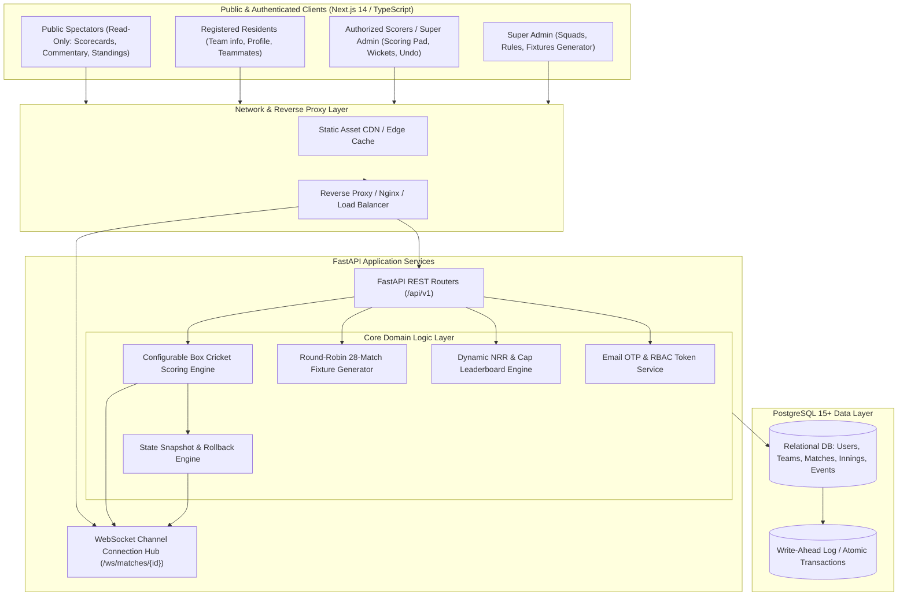

# SYSTEM ARCHITECTURE: BAIRAJESHWAR PREMIER LEAGUE (BPL)

## 1. Executive Architectural Overview

The **Bairajeshwar Premier League (BPL)** tournament platform is designed as a **public-first, real-time, database-driven sports management and broadcast platform**. It caters specifically to **residential box cricket**, where rules (such as net deflections, physical running constraints, bowler quotas, and last-man batting) vary from standard 11-a-side MCC regulations.

The architecture strictly enforces:
1. **Public-First Access**: Anonymous, zero-friction consumption of live scores, schedules, scorecards, leaderboards, and team rosters without mandatory authentication.
2. **Deterministic State-Sourced Box Cricket Scoring Engine**: Server-authoritative calculation of deliveries, strike rotations, over terminations, and instantaneous, mathematically consistent **Undo** capability.
3. **Role-Based Authorization Gate**: Scorer and Super Admin write isolation via cryptographically signed JWT sessions.
4. **Low-Latency Event-Driven Broadcasting**: WebSocket channel hubs streaming live delivery deltas with heartbeat reconnection and auto-hydration.

---

## 2. High-Level Architecture Diagram

---

## 3. Subsystem Architectural Breakdown

### 3.1 Frontend Architecture (Next.js 14 App Router)
- **Framework**: Next.js 14 with React 18, TypeScript, and Tailwind CSS.
- **Visual Identity**: Deep Emerald Green (`#047857`, `#064e3b`), Golden Yellow (`#fbbf24`), Pitch Dark Background (`#06130d`), and Slate typography.
- **Routing Structure**:
  - `/`: Public Homepage featuring Live Match prominently, tournament standings, and caps preview.
  - `/live` & `/live/[id]`: Dedicated live match scoreboard with ball-by-ball updates, full batting/bowling tables, and live commentary.
  - `/matches`: 28-match round-robin fixture directory with filters for `LIVE`, `UPCOMING`, and `COMPLETED`.
  - `/teams` & `/teams/[id]`: 8 participating franchises and squad rosters.
  - `/points-table`: Standings with automated Net Run Rate (NRR) and Top-4 qualification badges.
  - `/stats`: Orange Cap (runs) and Purple Cap (wickets) rankings.
  - `/profile`: Member-specific dashboard showing assigned franchise, captain, and teammates.
  - `/admin`: Super Admin overview metrics.
  - `/admin/teams`: Franchise squad builder (player assignment by unique BPL User ID).
  - `/admin/matches`: Single round-robin automated schedule generator.
  - `/admin/score/[id]`: High-tactility scoring keypad with box-cricket buttons (Direct Wall 4/6, Top Net Hit, One-Tip-One-Hand).
  - `/admin/settings`: Box cricket configuration panel (overs, wickets allowed, net rules, extras penalty).
- **Public-First Philosophy**: No route in the public browsing surface prompts or requires an account. Read operations never verify tokens.

### 3.2 Backend Architecture (FastAPI + SQLAlchemy 2.0)
- **Framework**: Python 3.11+ / FastAPI for asynchronous, high-throughput I/O.
- **Layered Architecture**:
  - `app/api/v1/`: Endpoint controllers handling payload serialization and HTTP responses.
  - `app/models/`: SQLAlchemy 2.0 declarative database models with explicit foreign keys and check constraints.
  - `app/schemas/`: Pydantic V2 schemas for strict data contract validation.
  - `app/services/`: Pure business logic completely decoupled from web endpoints (Box Cricket Engine, Tournament Scheduler, Undo Manager).
  - `app/utils/`: Cryptographic hashing, JWT signing/decoding, and email OTP dispatchers.
- **Concurrency & Transaction Safety**: Every ball event execution runs within an atomic database transaction (`db.commit()`), guaranteeing zero half-written state if a worker process interrupts.

### 3.3 Real-Time Communication Hub
- **Protocol**: Raw RFC 6455 WebSockets for sub-millisecond score broadcasting.
- **Channel Isolation**: Clients subscribe to `/ws/matches/{match_id}`.
- **Payload Design**: Full hydrated state broadcast on every delivery or undo event:
  - Total runs, wickets, overs formatted.
  - Striker & non-striker active statistics (runs, balls faced, boundaries, SR).
  - Current bowler spell (overs, maidens, runs conceded, wickets, economy).
  - Recent deliveries array (`4`, `W`, `1wd`, `2net`, `4wall`).
  - Required Run Rate (RRR) & Current Run Rate (CRR).
- **Client Auto-Recovery**: The frontend WebSocket hook manages auto-reconnect with exponential backoff and fallback polling if WebSocket connections fail.

---

## 4. Security & Permissions Matrix

| Resource / Capability | Public Visitor | Registered User | Team Captain | Scorer | Super Admin |
| :--- | :---: | :---: | :---: | :---: | :---: |
| View Live Scores & Commentary | ✅ | ✅ | ✅ | ✅ | ✅ |
| View Fixtures & Scorecards | ✅ | ✅ | ✅ | ✅ | ✅ |
| View Points Table & Player Caps | ✅ | ✅ | ✅ | ✅ | ✅ |
| View Personal Profile & Squad | ❌ | ✅ | ✅ | ✅ | ✅ |
| Record Ball Delivery / Extras | ❌ | ❌ | ❌ | ✅ | ✅ |
| Undo Delivery | ❌ | ❌ | ❌ | ✅ | ✅ |
| Change Bowler / Batsman Crease | ❌ | ❌ | ❌ | ✅ | ✅ |
| Initialize Match Lineups & Toss | ❌ | ❌ | ❌ | ✅ | ✅ |
| Create Franchises & Assign Squads | ❌ | ❌ | ❌ | ❌ | ✅ |
| Generate Round-Robin Schedule | ❌ | ❌ | ❌ | ❌ | ✅ |
| Configure Box Cricket Rules | ❌ | ❌ | ❌ | ❌ | ✅ |
| Assign Captains & Scorer Roles | ❌ | ❌ | ❌ | ❌ | ✅ |
