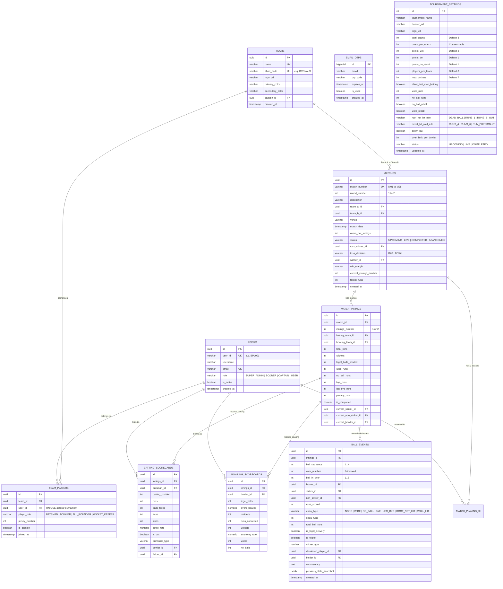

# DATABASE SCHEMA SPECIFICATION: POSTGRESQL

## 1. Schema Design Principles

The BPL database schema is designed to model **residential box cricket** with strict referential integrity, event-sourcing for deliveries, and high-performance indexing for live queries.

Key Principles:
1. **UUID Primary Keys**: Prevents enumeration attacks and simplifies distributed synchronization.
2. **Immutable Ball Events**: Every ball delivered in an innings is appended as an immutable event record.
3. **State Snapshotting**: Every `ball_events` row contains `previous_state_snapshot` (JSONB) capturing the exact micro-state of both scorecards and innings before the delivery occurred, enabling instant and bug-free undo.
4. **Configurable Box Cricket Regulations**: The `tournament_settings` table stores all customizable rules (overs, bowler quotas, net hits, wall runs, wickets allowed).

---

## 2. Entity-Relationship Diagram (ERD)

---

## 3. Detailed Table Specifications & Constraints

### 3.1 `users`
| Column | Type | Constraints | Description |
| :--- | :--- | :--- | :--- |
| `id` | UUID | PRIMARY KEY | Internal unique identifier |
| `user_id` | VARCHAR(20) | UNIQUE, NOT NULL | Public ID: `BPL001`, `BPL002`... |
| `username` | VARCHAR(100) | NOT NULL | Full name of resident |
| `email` | VARCHAR(255) | UNIQUE, NOT NULL | Gmail address |
| `role` | VARCHAR(20) | NOT NULL, DEFAULT 'USER' | `SUPER_ADMIN`, `SCORER`, `CAPTAIN`, `USER` |
| `is_active` | BOOLEAN | DEFAULT TRUE | Account state |
| `created_at` | TIMESTAMP WITH TIME ZONE | DEFAULT CURRENT_TIMESTAMP | Registration timestamp |

*Indexes*:
- `idx_users_user_id` (BTREE)
- `idx_users_email` (BTREE)

---

### 3.2 `teams` & `team_players`
- `teams.name` UNIQUE, `teams.short_code` UNIQUE (Max 8 franchises).
- `team_players.user_id` UNIQUE: **Guarantees no player can be assigned to multiple teams**.
- Foreign Keys configured with `ON DELETE CASCADE` for team player records when a team is removed.

---

### 3.3 `matches`
- `match_number` VARCHAR(20) UNIQUE (e.g. `M01` through `M28`).
- `overs_per_innings` INT: Inherited from tournament settings or overridden per match.
- `status` CHECK (`status IN ('UPCOMING', 'LIVE', 'COMPLETED', 'ABANDONED')`).
- `round_number` INT (1 to 7 for the 28-match round-robin phase).

*Indexes*:
- `idx_matches_status_date` ON (`status`, `match_date`)

---

### 3.4 `ball_events`
- `innings_id` REFERENCES `match_innings(id)` ON DELETE CASCADE.
- `ball_sequence` INT NOT NULL: Monotonically increasing counter per innings.
- `extra_type` CHECK (`extra_type IN ('NONE', 'WIDE', 'NO_BALL', 'BYE', 'LEG_BYE', 'PENALTY', 'ROOF_NET_HIT', 'WALL_HIT')`).
- `wicket_type` CHECK (`wicket_type IN ('BOWLED', 'CAUGHT', 'LBW', 'RUN_OUT', 'STUMPED', 'HIT_WICKET', 'ONE_TIP_ONE_HAND', 'ROOF_NET_CATCH', 'DIRECT_OUT_OF_BOX')`).
- `previous_state_snapshot` JSONB NOT NULL: Complete JSON representation of both scorecards and innings state before this delivery was applied.

*Indexes*:
- `idx_ball_events_innings_seq` ON (`innings_id`, `ball_sequence` DESC)
