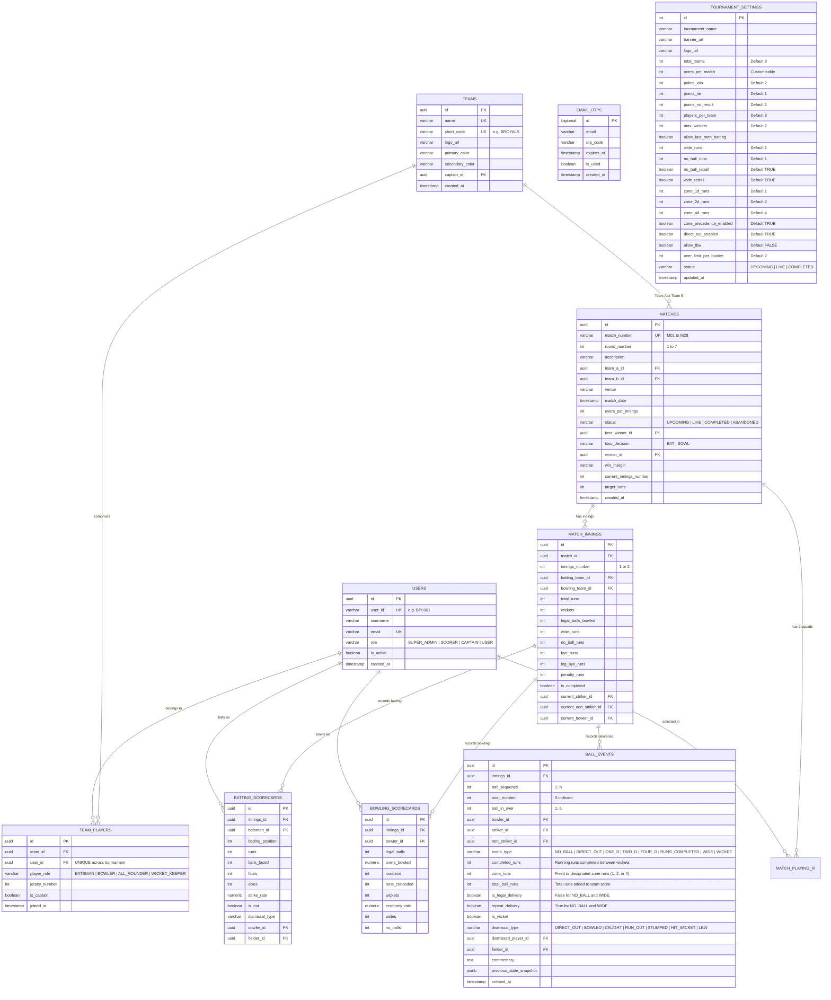

# DATABASE SCHEMA SPECIFICATION: POSTGRESQL

## 1. Schema Design Principles

The BPL database schema models an **open-air box cricket ground with a defined playing square, NO overhead net, designated scoring zones (1D, 2D, 4D), line no-balls, and direct out-of-square dismissals**.

Key Principles:
1. **Explicit Delivery Event Types**: The `ball_events` table explicitly tracks the confirmed BPL delivery types: `NO_BALL`, `DIRECT_OUT`, `ONE_D`, `TWO_D`, `FOUR_D`, `RUNS_COMPLETED`, `WIDE`, and `WICKET`.
2. **Deterministic Micro-Snapshots**: Every `ball_events` row stores `previous_state_snapshot` (JSONB) capturing the exact micro-state of both scorecards and innings before the delivery occurred, enabling instant and bug-free undo.
3. **Fixed 4 vs Running Runs**: `FOUR_D` deliveries record `fixed_runs = 4` with `completed_runs = 0`. `ONE_D` and `TWO_D` record zone runs plus any physically completed running runs.
4. **Scorer Account Authorization**: The `users.role` enum includes `SCORER` in addition to `SUPER_ADMIN`, `CAPTAIN`, and `USER`.
5. **Referential Integrity**: Strict foreign keys and constraints prevent orphan scoring events or invalid team assignments.

---

## 2. Entity-Relationship Diagram (ERD)

---

## 3. Key Table Specifications & Constraints

### 3.1 `tournament_settings`
| Column | Type | Constraints | Description |
| :--- | :--- | :--- | :--- |
| `id` | INT | PRIMARY KEY | Settings row identifier |
| `tournament_name` | VARCHAR(150) | NOT NULL | Official tournament name |
| `overs_per_match` | INT | DEFAULT 6 | Customizable match overs |
| `players_per_team` | INT | DEFAULT 8 | Box cricket squad size |
| `max_wickets` | INT | DEFAULT 7 | Wickets allowed before all out |
| `allow_last_man_batting` | BOOLEAN | DEFAULT FALSE | Last man can bat alone toggle |
| `wide_runs` | INT | DEFAULT 1 | Runs awarded for wide |
| `no_ball_runs` | INT | DEFAULT 1 | Runs awarded for line no-ball (+1) |
| `no_ball_reball` | BOOLEAN | DEFAULT TRUE | Line no-balls repeated |
| `wide_reball` | BOOLEAN | DEFAULT TRUE | Wides repeated |
| `zone_1d_runs` | INT | DEFAULT 1 | Runs for Zone 1D |
| `zone_2d_runs` | INT | DEFAULT 2 | Runs for Zone 2D |
| `zone_4d_runs` | INT | DEFAULT 4 | Runs for Zone 4D (Fixed 4) |
| `zone_precedence_enabled`| BOOLEAN | DEFAULT TRUE | 1D/2D/4D zones take precedence over square exits |
| `direct_out_enabled` | BOOLEAN | DEFAULT TRUE | Out if hit directly outside square |
| `allow_lbw` | BOOLEAN | DEFAULT FALSE | Disabled by default |
| `over_limit_per_bowler` | INT | DEFAULT 2 | Max overs per bowler |
| `status` | VARCHAR(50) | DEFAULT 'UPCOMING' | `UPCOMING`, `LIVE`, `COMPLETED` |

---

### 3.2 `ball_events`
| Column | Type | Constraints | Description |
| :--- | :--- | :--- | :--- |
| `id` | UUID | PRIMARY KEY | Event unique ID |
| `innings_id` | UUID | FOREIGN KEY, NOT NULL | Reference to `match_innings` |
| `ball_sequence` | INT | NOT NULL | Sequential delivery counter (1, 2, 3...) |
| `over_number` | INT | NOT NULL | 0-indexed over number |
| `ball_in_over` | INT | NOT NULL | 1 to 6 (0 for illegal deliveries) |
| `bowler_id` | UUID | FOREIGN KEY, NOT NULL | Active bowler |
| `striker_id` | UUID | FOREIGN KEY, NOT NULL | Active striker |
| `non_striker_id` | UUID | FOREIGN KEY, NULLABLE | Active non-striker (null for last-man) |
| `event_type` | VARCHAR(30) | NOT NULL | `NO_BALL`, `DIRECT_OUT`, `ONE_D`, `TWO_D`, `FOUR_D`, `RUNS_COMPLETED`, `WIDE`, `WICKET` |
| `completed_runs` | INT | DEFAULT 0 | Physical runs run between wickets |
| `zone_runs` | INT | DEFAULT 0 | Declared zone runs (1 for 1D, 2 for 2D, 4 for 4D) |
| `total_ball_runs` | INT | DEFAULT 0 | Total runs credited on this delivery |
| `is_legal_delivery` | BOOLEAN | DEFAULT TRUE | False for `NO_BALL` or `WIDE` |
| `repeat_delivery` | BOOLEAN | DEFAULT FALSE | True for `NO_BALL` or `WIDE` |
| `is_wicket` | BOOLEAN | DEFAULT FALSE | Wicket indicator |
| `dismissal_type` | VARCHAR(50) | NULLABLE | `DIRECT_OUT`, `BOWLED`, `CAUGHT`, `RUN_OUT`, `STUMPED`, `HIT_WICKET`, `LBW` |
| `dismissed_player_id` | UUID | FOREIGN KEY, NULLABLE | Dismissed batsman |
| `previous_state_snapshot`| JSONB | NOT NULL | Exact serialized JSON state for atomic undo |

*Indexes*:
- `idx_ball_events_innings_seq` ON (`innings_id`, `ball_sequence` DESC)
- `idx_ball_events_event_type` ON (`event_type`)
