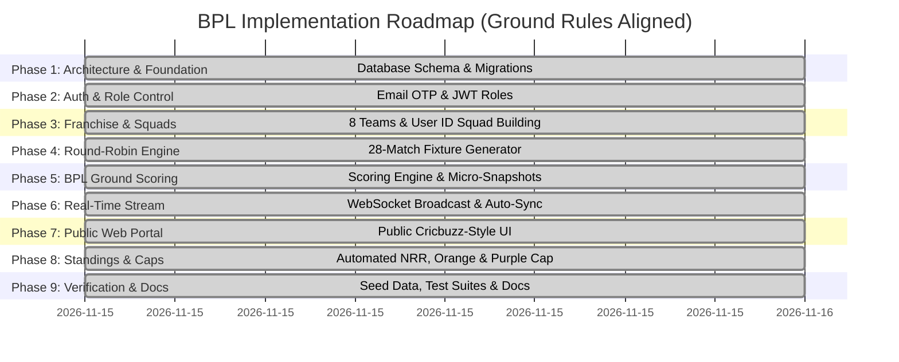

# IMPLEMENTATION ROADMAP: BAIRAJESHWAR PREMIER LEAGUE (BPL)

## 1. Phased Development Roadmap

The development of the platform is divided into 9 independent, verifiable phases aligned with the official BPL ground configuration (**defined square, NO overhead net, zones 1D/2D/4, line no-balls, direct out of square dismissal**).

---

## 2. Phase-by-Phase Verification Checklist

### Phase 1: Foundation & PostgreSQL Schema
- [x] SQLAlchemy 2.0 models reflecting BPL ground rules: `users`, `teams`, `team_players`, `matches`, `match_innings`, `batting_scorecards`, `bowling_scorecards`, `ball_events`, and `tournament_settings`.
- [x] Constraints: Unique `BPLxxx` user IDs, unique team short codes, single team membership per resident.
- [x] Removed all overhead net columns and rules.
- [x] Added dedicated scoring zones (`ZONE_1D`, `ZONE_2D`, `ZONE_4`) and dismissal `DIRECT_OUT_OF_SQUARE`.

### Phase 2: Authentication & Permissions System
- [x] Email OTP verification service (no passwords).
- [x] Deterministic User ID generator (`BPL001`, `BPL002`...).
- [x] Cryptographic JWT creation and claim validation.
- [x] Distinct roles: `SUPER_ADMIN`, `SCORER`, `CAPTAIN`, `USER`.
- [x] Unauthenticated public access for all spectators.

### Phase 3: Franchise & Squad Administration
- [x] 8 participating residential teams.
- [x] Assign registered residents by User ID to team squads without duplicate membership.
- [x] Assign captaincy linked directly to the team model.
- [x] Member profile endpoint (`/api/v1/auth/me`) returning personal team, captain, and teammates.

### Phase 4: Tournament Engine & Fixtures
- [x] 28-match single round-robin scheduling algorithm (Berger cyclic tables).
- [x] Configurable match overs, venue, and start times.
- [x] Match lifecycle progression (`UPCOMING` -> `LIVE` -> `COMPLETED`).

### Phase 5: BPL Ground Scoring Engine & Rules
- [x] Configurable overs per match, players per team, and wickets allowed.
- [x] BPL scoring zones: Zone 1D (1 run), Zone 2D (2 runs), Zone 4 (4 runs).
- [x] Physical runs tracking: Striker and non-striker can run additional runs.
- [x] Strike rotation on odd physical runs completed and at end of each 6-ball over.
- [x] Line no-ball: +1 extra run, ball is re-bowled, not counted as legal, and recorded separately in bowling & batting scorecards.
- [x] Dismissal `DIRECT_OUT_OF_SQUARE`: Ball hit directly out of the square without bouncing.
- [x] **Deterministic Undo**: Micro-snapshots of innings and scorecard state restored atomically on demand.

### Phase 6: WebSocket Real-Time Broadcasting
- [x] Channel manager `/ws/matches/{match_id}`.
- [x] Automated delivery and undo delta broadcast without page refresh.
- [x] Resilient frontend WebSocket hook with auto-reconnection.

### Phase 7: Public Web Experience
- [x] Professional cricket visual identity with Deep Emerald Green & Golden Yellow accents.
- [x] Public homepage with prominent Live Match Card, upcoming fixtures, and cap leaders.
- [x] Ball-by-ball live match commentary and full interactive digital scorecards.
- [x] Scorer control pad equipped with 1D, 2D, 4, Line NB, Wide, Out of Square, and Undo buttons.
- [x] Responsive layout optimized for mobile smartphones, tablets, and desktop displays.

### Phase 8: Automated Standings & Player Caps
- [x] Net Run Rate (NRR) dynamically re-computed across all completed matches.
- [x] Standings table with positions, wins, losses, ties, points, and Top-4 qualification markers.
- [x] Individual leaderboards: Orange Cap (leading run scorer) and Purple Cap (top wicket taker).

### Phase 9: Testing & Documentation
- [x] Unit test suites for zone scoring, line no-balls, direct out of square dismissals, and rollback undo.
- [x] Updated architectural documentation in `docs/`:
  - `docs/ARCHITECTURE.md`
  - `docs/DATABASE_SCHEMA.md`
  - `docs/API_SPECIFICATION.md`
  - `docs/SCORING_ENGINE.md`
  - `docs/IMPLEMENTATION_ROADMAP.md`
