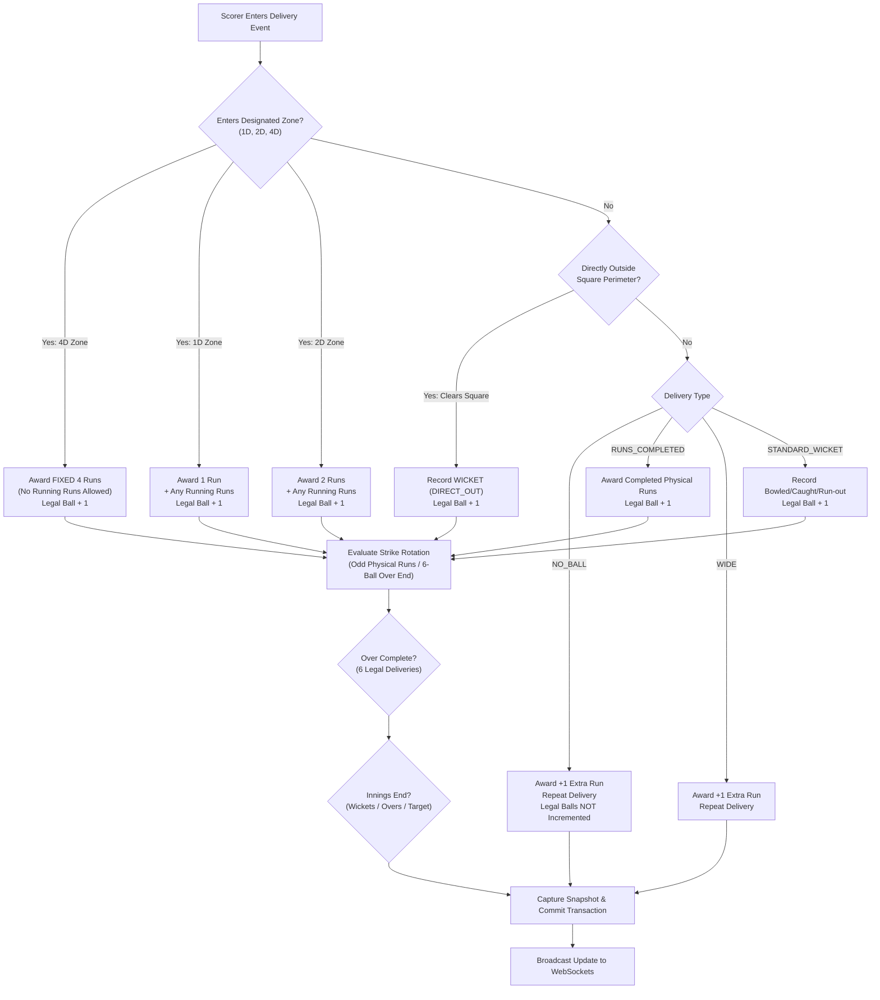

# BOX CRICKET SCORING ENGINE & TOURNAMENT ENGINE

## 1. Box Cricket Scoring Engine Design

The **Bairajeshwar Premier League (BPL)** is played on an open-air defined square turf ground with **NO overhead net**. The engine strictly enforces the **confirmed BPL ground rules**:
1. **Directly Outside Square = OUT**: If the ball goes directly outside the defined playing square, the batter is **OUT** (`DIRECT_OUT`).
2. **Line No-Ball = +1 RUN & REPEAT**: Awards 1 extra run to the batting team, delivery is repeated, and does not count as a legal delivery towards the over count.
3. **Four-Zone Scoring (4D) = FIXED 4**: Hitting the 4D zone awards exactly 4 runs. Additional running runs are **not** added.
4. **Zone 1D = 1 Run**: Awards 1 run.
5. **Zone 2D = 2 Runs**: Awards 2 runs.
6. **Running Between Wickets (`RUNS_COMPLETED`)**: Completed physical runs between wickets.
7. **Zone Precedence Safeguard**: The engine enforces a strict spatial precedence check—balls entering designated scoring zones (1D, 2D, 4D) are scored as zone runs and take precedence over square exits. A ball is only ruled `DIRECT_OUT` when it clears the perimeter outside of all designated scoring zones.



---

## 2. Formal Implementation Engine Logic

The core delivery processing implementation follows this exact specification:

```python
def process_delivery(event, match_state, settings):
    """
    Evaluates delivery according to confirmed BPL box cricket ground rules.
    Guarantees that 1D, 2D, and 4D zones take precedence before checking square boundary exits.
    """
    # 1. Capture full micro-snapshot of scorecards & innings prior to mutation
    snapshot = capture_snapshot(match_state)

    # 2. NO-BALL Rule: +1 Run, Repeated delivery, Does NOT count as legal ball
    if event.type == "NO_BALL":
        match_state.batting_score += 1
        match_state.extras["no_ball"] += 1
        match_state.current_bowler.no_balls += 1
        match_state.current_bowler.runs_conceded += 1
        # If runs were run off the bat during the no-ball
        if event.completed_runs > 0:
            match_state.batting_score += event.completed_runs
            match_state.current_striker.runs += event.completed_runs
            if event.completed_runs % 2 == 1:
                rotate_strike(match_state)
        return {
            "legal_delivery": False,
            "repeat_delivery": True,
            "snapshot": snapshot
        }

    # 3. Designated Scoring Zones (Take strict precedence according to ground layout)
    if event.type == "FOUR_D":
        # FIXED 4: Exactly 4 runs awarded. Additional running runs are NOT added.
        match_state.batting_score += 4
        match_state.current_striker.runs += 4
        match_state.current_striker.fours += 1
        match_state.current_striker.balls_faced += 1
        match_state.current_bowler.runs_conceded += 4
        match_state.current_bowler.legal_balls += 1
        match_state.legal_balls += 1
        # Fixed 4 means batsmen do not run, strike does not rotate
        physical_runs_for_rotation = 0

    elif event.type == "ONE_D":
        # 1D = 1 run (plus any physically completed runs)
        zone_runs = 1
        running_runs = event.completed_runs or 0
        total_runs = zone_runs + running_runs
        match_state.batting_score += total_runs
        match_state.current_striker.runs += total_runs
        match_state.current_striker.balls_faced += 1
        match_state.current_bowler.runs_conceded += total_runs
        match_state.current_bowler.legal_balls += 1
        match_state.legal_balls += 1
        physical_runs_for_rotation = running_runs

    elif event.type == "TWO_D":
        # 2D = 2 runs (plus any physically completed runs)
        zone_runs = 2
        running_runs = event.completed_runs or 0
        total_runs = zone_runs + running_runs
        match_state.batting_score += total_runs
        match_state.current_striker.runs += total_runs
        match_state.current_striker.balls_faced += 1
        match_state.current_bowler.runs_conceded += total_runs
        match_state.current_bowler.legal_balls += 1
        match_state.legal_balls += 1
        physical_runs_for_rotation = running_runs

    elif event.type == "RUNS_COMPLETED":
        # Pure running between wickets
        runs = event.completed_runs
        match_state.batting_score += runs
        match_state.current_striker.runs += runs
        match_state.current_striker.balls_faced += 1
        match_state.current_bowler.runs_conceded += runs
        match_state.current_bowler.legal_balls += 1
        match_state.legal_balls += 1
        physical_runs_for_rotation = runs

    # 4. Ball Goes Outside the Defined Square (Outside scoring zones) -> OUT
    elif event.type == "DIRECT_OUT":
        record_wicket(match_state, dismissal_type="DIRECT_OUT")
        match_state.current_striker.balls_faced += 1
        match_state.current_bowler.legal_balls += 1
        match_state.legal_balls += 1
        physical_runs_for_rotation = 0

    # 5. Standard Dismissals (Bowled, Caught, Run-Out, Stumped, Hit Wicket)
    elif event.type == "WICKET":
        record_wicket(match_state, dismissal_type=event.wicket_type)
        match_state.current_striker.balls_faced += 1
        match_state.current_bowler.legal_balls += 1
        match_state.legal_balls += 1
        physical_runs_for_rotation = 0

    # 6. Strike Rotation: Rotates on odd physically run runs
    if physical_runs_for_rotation % 2 == 1:
        rotate_strike(match_state)

    # 7. Over Completion (6 legal balls): Change strike and reset bowler
    if match_state.legal_balls % 6 == 0 and event.type != "NO_BALL":
        rotate_strike(match_state)
        match_state.current_bowler = None

    # 8. Check Innings / Match Completion
    check_innings_completion(match_state, settings)

    return update_scorecard(match_state)
```

---

## 3. Ground Safeguards & Precedence Rules

### 3.1 Zone Precedence Safeguard
On the physical ground, the designated scoring zones (1D, 2D, 4D) occupy specific perimeter markings on the square turf.
- When the ball strikes or crosses into the **1D**, **2D**, or **4D** zones, the engine **must evaluate the zone score first**.
- A ball is **only** evaluated as `DIRECT_OUT` if it travels directly out of the square outside the boundaries of any valid scoring zone.
- This prevents valid boundary shots from being misclassified as out-of-square dismissals.

### 3.2 Fixed 4 Rule
In standard cricket, batsmen may run while a boundary is being fielded. Under BPL ground rules:
- Zone **4D** is a **FIXED 4**.
- Additional physical running runs are **strictly disallowed and omitted**.
- Strike does not rotate (batsmen stay at their respective ends).

### 3.3 Line No-Ball Extra Accounting
- When the bowler steps behind/over the designated line:
  - Batter cannot be dismissed except via Run Out.
  - Delivery is repeated and legal ball count remains unchanged.
  - +1 extra run credited to team extras and charged to bowler conceded runs.
  - Line no-balls are logged with full snapshot for instantaneous undo.

---

## 4. Atomic Undo Verification

Every delivery stores `previous_state_snapshot` (JSONB) capturing:
- `batting_score`, `wickets`, `legal_balls`, `extras`
- Active striker and non-striker IDs
- Active bowler ID and complete bowling scorecard state
- Individual batting scorecard states (runs, balls, 4s, 6s, dismissal)

When the scorer triggers **UNDO**:
1. The most recent `ball_event` is queried.
2. The entire innings state and active scorecards are restored from the JSON snapshot.
3. The `ball_event` row is deleted.
4. The atomic commit triggers a WebSocket broadcast, syncing all public scoreboards back to the exact previous state in < 15ms.

---

## 5. Tournament Round-Robin Engine (28 Matches)

- **Franchises**: 8 Teams.
- **League Stage**: Single Round-Robin: $\frac{8 \times 7}{2} = 28$ Matches.
- **Scheduling**: Berger cyclic rotation across 7 rounds (4 matches per round).
- **Points**: Win = 2, Tie/No Result = 1, Loss = 0.
- **Dynamic Net Run Rate (NRR)**:
  $$\text{NRR} = \left( \frac{\text{Runs Scored}}{\text{Overs Faced}} \right) - \left( \frac{\text{Runs Conceded}}{\text{Overs Bowled}} \right)$$
  *(Teams all-out are credited with their full allotted quota of overs).*
