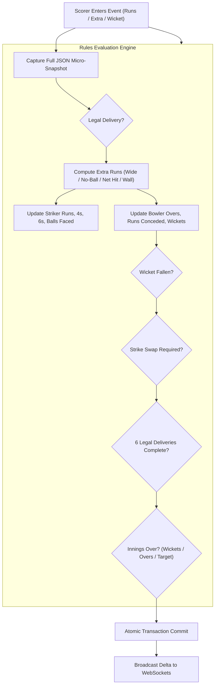
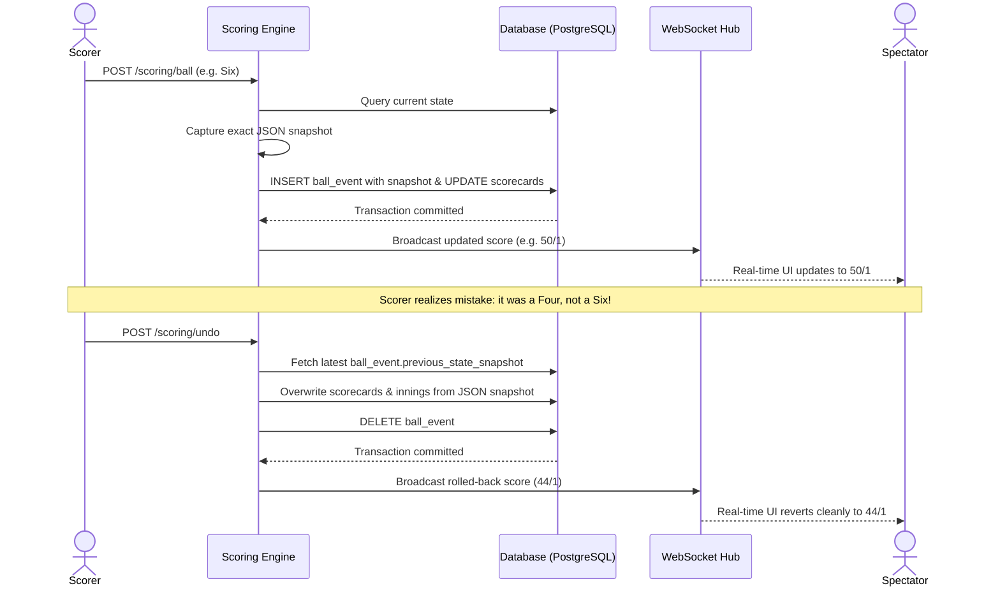

# BOX CRICKET SCORING ENGINE & TOURNAMENT ENGINE

## 1. Box Cricket Scoring Engine Design

Traditional 11-a-side cricket engines fail when applied to residential box cricket due to unique environmental and physical constraints. The BPL engine is built around a **configurable rules processor**.

---

## 2. Core Box Cricket Scoring Rules & Edge-Cases

### 2.1 Configurable Parameters
1. **Overs per Match**: Dynamic integer (e.g., 6, 8, 10, or 12 overs).
2. **Players per Team**: 6 to 11 players.
3. **Max Wickets Allowed**: Configurable (e.g. 7 wickets for 8 players, or all-out).
4. **Last-Man Batting**: If enabled, when only one batsman remains, they can bat alone without a non-striker.
5. **Over Quota per Bowler**: Maximum overs an individual player can bowl in the match (default: 2 overs in a 6-over game).

### 2.2 Ball Classification & Extras
- **Standard Runs**: `0, 1, 2, 3, 4, 6`. Added to batsman and batting team.
- **Wide**: Adds configured penalty runs (default +1 or +2) to team and bowler. If `wide_reball = True`, legal ball counter does **not** increment.
- **No-Ball**: Adds configured penalty runs (+1 or +2) to team and bowler. Next delivery is a Free Hit.
- **Byes & Leg Byes**: Legal delivery. Runs added to team extras, but **not** credited to batsman and **not** charged against bowler's conceded runs.
- **Direct Wall Strike (`WALL_HIT`)**: In box cricket, striking designated perimeter walls awards declared runs (e.g. direct boundary wall = 4 runs or 6 runs) without physical running.
- **Roof / Top Net Hit (`ROOF_NET_HIT`)**: Configurable as:
  - `DEAD_BALL`: Replay delivery, no runs.
  - `RUNS_1` or `RUNS_2`: Adds 1 or 2 runs to team score.
  - `OUT`: Declared dismissal.

### 2.3 Box Cricket Dismissal Classifications
- `BOWLED`: Standard dismissal. Credited to bowler.
- `CAUGHT`: Standard catch. Credited to bowler and fielder.
- `RUN_OUT`: Physical running dismissal. Charged to dismissed batsman, not charged as a bowler wicket.
- `ONE_TIP_ONE_HAND`: A ball caught with one hand after exactly one bounce inside the box. Credited to bowler and catcher.
- `ROOF_NET_CATCH`: A deflection off the upper netting caught before hitting the turf. Credited to bowler and catcher.
- `DIRECT_OUT_OF_BOX`: Any ball hit directly over the box enclosure without bouncing. Out per tournament ground rules.
- `LBW`: Configurable; disabled by default for box cricket.

### 2.4 Strike Rotation Mechanics
- Odd physical runs (1, 3, 5): Striker and non-striker swap ends.
- Even runs (0, 2, 4, 6): Batsmen retain ends.
- Over completion (6 legal deliveries):
  - Batsmen swap ends (non-striker faces first ball of subsequent over).
  - Active bowler cleared, prompting scorer to designate next bowler.

---

## 3. High-Fidelity Atomic Undo Architecture

Accidental scorer clicks are guaranteed to occur in fast-paced box cricket matches. The BPL undo engine uses a **deterministic micro-snapshot pattern**:

---

## 4. Tournament Engine & Round-Robin Generator

### 4.1 Single Round-Robin League (28 Matches)
For 8 teams ($N = 8$), the total number of matches in a single round-robin tournament is mathematically:
$$\text{Total Matches} = \frac{N \times (N - 1)}{2} = \frac{8 \times 7}{2} = 28 \text{ Matches}$$

The tournament runs across **7 Rounds**, with 4 matches per round.

### 4.2 Berger Tables (Round-Robin Cyclic Algorithm)
To ensure balanced scheduling where no team plays two matches simultaneously:
1. Fix Team 1 at position 0.
2. Rotate the remaining 7 teams cyclically for each round $r \in [1..7]$.
3. For Round $r$, pairings are:
   - Match 1: Team 1 vs Team $k_1$
   - Match 2: Team $k_2$ vs Team $k_3$
   - Match 3: Team $k_4$ vs Team $k_5$
   - Match 4: Team $k_6$ vs Team $k_7$
4. Automatically assigns Match numbers `M01` through `M28`.

### 4.3 Net Run Rate (NRR) Formula
After each completed match, the NRR is calculated across all completed innings:
$$\text{NRR} = \left( \frac{\text{Total Runs Scored by Team}}{\text{Total Overs Faced by Team}} \right) - \left( \frac{\text{Total Runs Conceded by Team}}{\text{Total Overs Bowled by Team}} \right)$$

*Special Rule*: If a team is bowled out (all wickets lost) before completing its allotted quota of overs, the calculation uses the **full allotted overs quota** rather than the balls actually faced.
