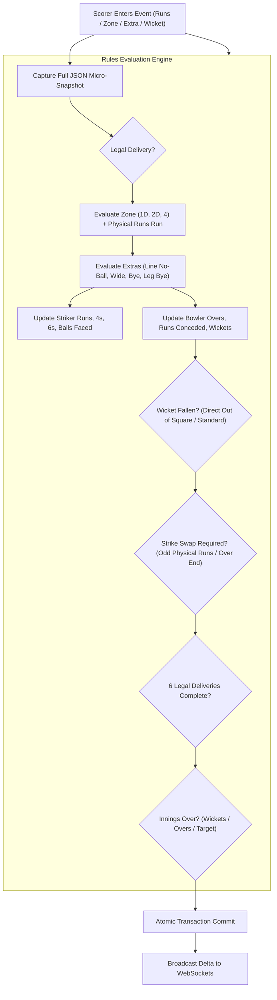
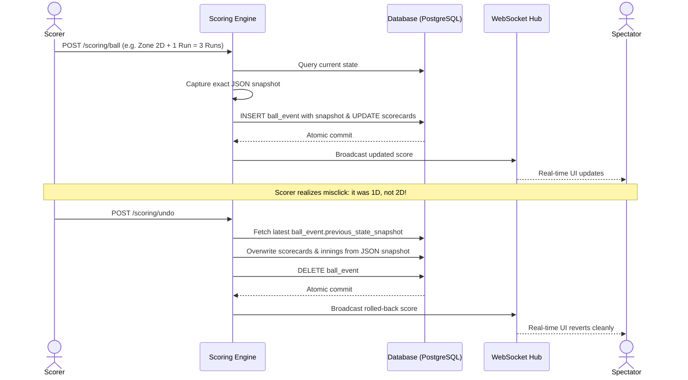

# BOX CRICKET SCORING ENGINE & TOURNAMENT ENGINE

## 1. Box Cricket Scoring Engine Design

The **Bairajeshwar Premier League (BPL)** is played on an open-air defined square turf ground with **NO overhead net**. The engine accurately models this specific ground configuration with declared scoring zones, line no-balls, direct out-of-square dismissals, physical running, and server-authoritative state calculations.

---

## 2. Official BPL Ground & Scoring Rules

### 2.1 Ground Configuration
1. **Defined Playing Square**: The field is bounded by a marked square perimeter on the ground.
2. **NO Overhead Net**: There is no top net or ceiling enclosure. All overhead roof-net rules and deflections are excluded.
3. **Direct Out of Square Dismissal (`DIRECT_OUT_OF_SQUARE`)**:
   - If the ball is hit **directly outside the defined playing square without bouncing**, the batsman is **OUT**.
   - Recorded as dismissal type `DIRECT_OUT_OF_SQUARE`.
   - Credited as a wicket in the innings total and charged to the dismissed batsman.
4. **Designated Scoring Zones**:
   - **Zone 1D**: Awards **1 run**.
   - **Zone 2D**: Awards **2 runs**.
   - **Zone 4**: Awards **4 runs**.
5. **Physical Running**:
   - Both the striker and non-striker can run between the wickets to complete additional runs (or run all runs physically).
   - Strike rotates whenever the total physical runs completed is an odd number (1, 3, 5).

### 2.2 Bowling & Line No-Ball Rules
1. **Designated No-Ball Line**:
   - A marked crease line is established for the bowler.
   - If the bowler delivers the ball from **behind or over the designated line**, it is called a **NO-BALL**.
2. **Scoring Penalty & Status**:
   - Awards **1 extra run** to the batting team.
   - Does **NOT** count as a legal delivery towards the 6-ball over count (ball must be re-bowled).
   - The delivery does not terminate the innings; batting team continues the innings.
   - Bowler is charged with 1 no-ball in the bowling scorecard, and 1 extra run is added to bowler runs conceded.
   - Any physical runs completed off the bat during a no-ball are credited to the batsman, while the +1 penalty is credited to team extras.
3. **Wide Deliveries**:
   - A delivery outside the designated tramlines is called a **WIDE**.
   - Awards **1 extra run** (configurable) to batting team extras and conceded by bowler.
   - Does not count as a legal ball towards the over count.

### 2.3 Strike Rotation Mechanics
- **Physical Runs**: Strike rotates between striker and non-striker on odd runs (1, 3, 5 physical runs completed).
- **Even Runs (0, 2, 4, 6)**: Batsmen remain at their respective crease ends.
- **Over Completion (6 Legal Deliveries)**:
  - Strike changes ends: the non-striker faces the first ball of the subsequent over.
  - Active bowler is reset, requiring the scorer to select the bowler for the next over.
  - A single bowler cannot exceed the tournament over limit (e.g. max 2 overs per bowler in a standard match).

### 2.4 Dismissal Types Supported
- `BOWLED`: Clean bowled hitting the wickets. Credited to bowler.
- `CAUGHT`: Caught by a fielder inside the playing square. Credited to bowler and catcher.
- `RUN_OUT`: Physical run-out while attempting runs between wickets. Charged to the dismissed batsman; not credited to the bowler.
- `STUMPED`: Wicket-keeper stumping outside the crease. Credited to bowler and keeper.
- `HIT_WICKET`: Batsman breaks wickets with bat or body. Credited to bowler.
- `DIRECT_OUT_OF_SQUARE`: Ball hit directly outside the marked playing square on the full.
- `LBW`: Configurable; disabled by default unless tournament rules explicitly enable it.

---

## 3. High-Fidelity Atomic Undo Architecture

Accidental scorer input during fast-paced play is handled via **deterministic state snapshotting**:

---

## 4. Tournament Engine & Round-Robin Generator

### 4.1 Single Round-Robin League (28 Matches)
For 8 teams ($N = 8$), the league stage consists of:
$$\text{Total Matches} = \frac{N \times (N - 1)}{2} = \frac{8 \times 7}{2} = 28 \text{ Matches}$$

The tournament runs across **7 Rounds**, with exactly 4 matches per round.

### 4.2 Berger Cyclic Round-Robin Scheduling
- Fix Team 1 at position 0.
- Rotate the remaining 7 teams cyclically for each round $r \in [1..7]$.
- Guarantees balanced scheduling where no team plays two matches in the same round.
- Automatically generates sequential match numbers `M01` through `M28`.

### 4.3 Net Run Rate (NRR) Formula
$$\text{NRR} = \left( \frac{\text{Total Runs Scored by Team}}{\text{Total Overs Faced by Team}} \right) - \left( \frac{\text{Total Runs Conceded by Team}}{\text{Total Overs Bowled by Team}} \right)$$

*All-Out Rule*: If a team is bowled out before completing their allotted overs, the calculation uses their **full allotted overs quota** rather than the balls actually faced.
